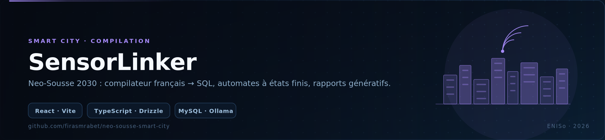
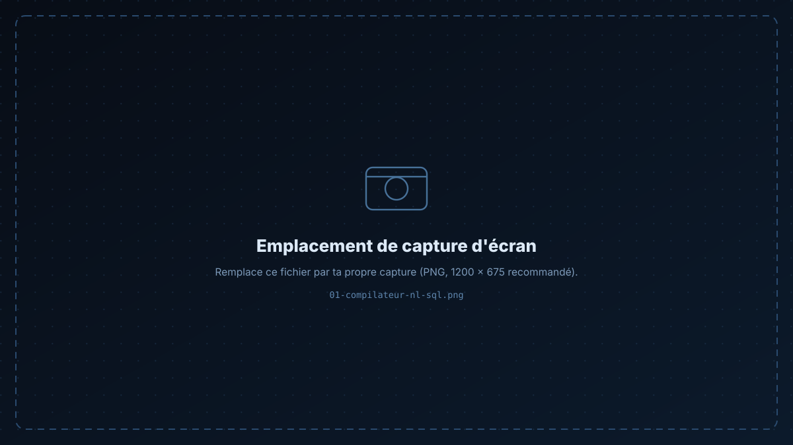

<p align="center">
  
</p>

<p align="center">
  
  
  
  
  
  
  
</p>

<h1 align="center">SensorLinker</h1>

<p align="center">
<b>Neo-Sousse 2030</b> — la plateforme Smart City qui relie les capteurs urbains à une base de données,<br/>
et le langage naturel à SQL. Projet académique — <i>Théorie des Langages &amp; Compilation</i>, ENISo.
</p>

<p align="center">
  <a href="#-fonctionnalités">Fonctionnalités</a> ·
  <a href="#-architecture">Architecture</a> ·
  <a href="#-démarrage">Démarrage</a> ·
  <a href="#-compilateur-nl--sql">Compilateur</a>
</p>

---

## 📸 Captures

> Remplace les deux emplacements ci-dessous par tes captures (`docs/screenshots/01-compilateur-nl-sql.png`), puis mets à jour les chemins.

<p align="center">
  
  
</p>

---

## ✨ Fonctionnalités

- **🗣 Compilateur français → SQL** — une requête écrite en langage naturel (« quels capteurs de la zone industrielle ont dépassé le seuil de pollution cette semaine ? ») est analysée puis traduite en SQL exécutable.
- **🔄 Automates à états finis (DFA)** — le cycle de vie des entités urbaines (capteur → signalement → intervention → clôture) est modélisé par un automate : chaque transition illégale est rejetée.
- **🤖 Module d'IA générative** — génération des rapports d'intervention et validation assistée, via un LLM local servi par **Ollama**.
- **🗺 Tableau de bord** — visualisation des capteurs, signalements et interventions, en React + Tailwind (composants Radix / shadcn).
- **🔐 OAuth Google** — connexion des agents municipaux.

---

## 🏗 Architecture

```
├── compiler-pm-phase2/     # compilateur : lexer · parser · automate · génération SQL
├── backend/                # API Express (port 4001) + Drizzle ORM
│   └── dev.db              # SQLite en développement (DEV_SQLITE=true)
├── frontend/               # React + Vite (port 3000)
├── shared/                 # types & schémas partagés
├── SQL_QUERIES.sql         # requêtes de référence / jeu de test
└── drizzle.config.ts       # configuration de la base
```

```
Question (français)
       │
       ▼
 [ lexer ] → [ parser ] → [ analyse sémantique ] → [ DFA : validité de l'entité ]
       │
       ▼
  SQL généré → MySQL / SQLite → tableau de bord React
```

---

## 🚀 Démarrage

```bash
# 1 — dépendances
npm install

# 2 — configuration
cp .env.example .env          # MySQL (ou DEV_SQLITE=true pour un fichier local)

# 3 — schéma de base
npm run db:push

# 4 — backend (API, :4001)
npm run dev

# 5 — frontend (Vite, :3000), dans un autre terminal
npm run frontend
```

| Variable | Rôle |
|:--|:--|
| `MYSQL_HOST` · `MYSQL_PORT` · `MYSQL_USER` · `MYSQL_PASSWORD` · `MYSQL_DATABASE` | connexion MySQL |
| `DEV_SQLITE` / `SQLITE_FILE` | bascule sur SQLite pour le développement |
| `PORT` / `VITE_PORT` | ports backend / frontend |

---

## 🧩 Compilateur NL → SQL

Le dossier `compiler-pm-phase2/` contient les trois phases du projet de compilation :

1. **Phase 1 — analyse lexicale** : tokenisation de la phrase française (entités, zones, seuils, opérateurs temporels).
2. **Phase 2 — analyse syntaxique et sémantique** : grammaire, arbre de dérivation, vérification que l'entité interrogée existe et que son état courant autorise la requête (rôle du DFA).
3. **Génération** : production du SQL cible, exécuté sur la base de la ville.

---

## 🛠 Stack

**Frontend** React · Vite · TypeScript · Tailwind CSS · Radix UI · Recharts
**Backend** Express · Drizzle ORM · MySQL / SQLite · Google OAuth
**IA & compilation** Ollama (LLM local) · automates à états finis · analyse lexicale/syntaxique maison

---

<div align="center">

**Firas Mrabet** — Élève ingénieur en informatique appliquée @ ENISo

[GitHub](https://github.com/firasmrabet) · [LinkedIn](https://www.linkedin.com/in/firas-mrabet-98779934b) · [Portfolio](https://firas-mrabet-portfoliowebsite.vercel.app) · [Email](mailto:firasmrabet1603@gmail.com)

</div>
